# Auditoría UX de Arrival: antes y después

Rama `feat/ux-intuitiva` (desde `redesign/impeccable`). Usuario objetivo: estudiante de fuera de la UE que llega a Madrid (persona demo **Priya**, India, máster, llega el 25 de enero de 2027). Recorrido hecho en móvil (375 × 812) y escritorio (1280 × 800) con el flujo onboarding → home → checklist → trámite → asistente.

Objetivo: **en 5 segundos el estudiante sabe qué tiene que hacer hoy y por qué.**

Capturas en `docs/ux-audit/before/` y `docs/ux-audit/after/`. Se regeneran con el script descrito al final.

---

## Los 10 problemas más graves (antes)

| # | Dónde | Problema | Por qué importa |
|---|---|---|---|
| 1 | Home | **No hay una acción principal.** Lo primero que se ve es la tarjeta de embarque decorativa (IND → MAD). "Next stop" aparece en el tercer bloque y compite con 3 accesos directos, el itinerario completo y la tarjeta del asistente. Además, la tarjeta pone "Purpose: Erasmus" a una estudiante de máster de fuera de la UE. | El estudiante no sabe qué hacer hoy ni por qué. Ver "Erasmus" a un alumno no UE le quita confianza. |
| 2 | Todas (móvil) | **Capas flotantes que tapan contenido.** El botón de voz flota encima de los accesos directos, del estado "done" de las filas y de los pasos del trámite. Con la barra de navegación, ocupan unos 170 px de 812. | El usuario no lee lo que hay debajo y tiene que desplazarse para pulsar. |
| 3 | Navegación | **Iconos sin texto.** Solo la pestaña activa lleva etiqueta. "Chat" es ambiguo (personas o asistente) y el asistente no está en la barra: solo se llega a él desde una tarjeta al final de la home o desde el menú rápido. | El asistente, que es una ventaja del producto, queda escondido. |
| 4 | Checklist | **El "por qué está bloqueado" va en letra manuscrita** (Reenie Beanie, 21 px): "needs proof of sufficient funds + criminal record certificate first". Los arcos solo se entienden después de leer un párrafo con jerga ("charted", "rail", "arcs"), y el marcador "TODAY −63" está en vertical. | Un lector con el inglés como segunda lengua y estrés no lo descifra, y un lector de pantalla tampoco recibe el motivo. |
| 5 | Detalle del trámite | **La acción queda bajo el pliegue y repartida en pestañas.** "Mark as done" está debajo de la descripción, dentro de una de 3 pestañas, y la tapa la barra de navegación. Los documentos están en otra pestaña. El bloqueo se explica en una línea de 13 px después del botón desactivado. El número "08" de 88 px ocupa medio encabezado. | Hacen falta más toques de la cuenta y el estudiante no ve qué pasos y qué documentos necesita de un vistazo. |
| 6 | Todas | **Se ve el selector interno "Chart / Minimal"** en onboarding, checklist y detalle. | Es una herramienta de diseño, no del estudiante, y genera ruido y dudas ("¿qué es Chart?"). |
| 7 | Onboarding | **Demasiadas preguntas y opciones que no cuentan.** La bienvenida enseña 7 personas demo (Italia, Alemania, EE. UU.) con tanto peso como el botón principal. Se pide nombre, universidad y duración, que no cambian el checklist. Solo hay "Indian", "Chinese" y "Other non-EU" como nacionalidades. "Study exchange" no describe a un alumno de grado o máster. Son unos 10 toques sin avance automático. | El objetivo es menos de 60 s y 4 datos: nacionalidad, ciudad, motivo y fecha. |
| 8 | Home y asistente | **Tres tipografías y mayúsculas monoespaciadas por todas partes.** Instrument Serif en la home, el asistente y la barra lateral, Archivo en el resto, y etiquetas en IBM Plex Mono en mayúsculas espaciadas ("NEXT STOP", "VERIFIED SOURCES · MADRID"). Va en contra de `DESIGN.md`. | Parecen dos apps distintas, y las mayúsculas espaciadas cuestan de leer. |
| 9 | Accesibilidad e internacionalización | Hay objetivos táctiles de 32 a 36 px (botones de cabecera `h-9` y valoración `h-8`). Se usa `truncate` en títulos y motivos de bloqueo ("Needs Admission and tuition paid + Health…"), lo que rompe con textos largos en alemán. Todo usa propiedades físicas (`left`, `pl-[272px]`, `ml-auto`, flechas →), así que en árabe (RTL) el diseño se invierte mal. | Contraste AA bien en el texto, mal en los objetivos táctiles y en RTL. |
| 10 | Asistente | Encima del campo de texto hay 3 líneas de introducción y 6 sugerencias. El campo flotante tapa las sugerencias. La sugerencia "Community" ("¿qué seguro eligen otros estudiantes?") no se puede responder con contenido verificado. Si falla la red, no hay botón de reintentar. | El primer mensaje tarda y una de las sugerencias lleva a un callejón sin salida. |

Problemas menores encontrados: la carga es un "Loading…" en monoespaciada, sin esqueleto. No hay estado de "todo hecho" en la home. Barcelona no tiene contenido verificado (solo existe `content/madrid.json` para España).

### Capturas: antes

Móvil, primera pantalla (lo que el estudiante ve en los primeros 5 segundos):

| Onboarding | Home | Checklist | Trámite (TIE, bloqueado) | Asistente |
|---|---|---|---|---|
|  |  |  | 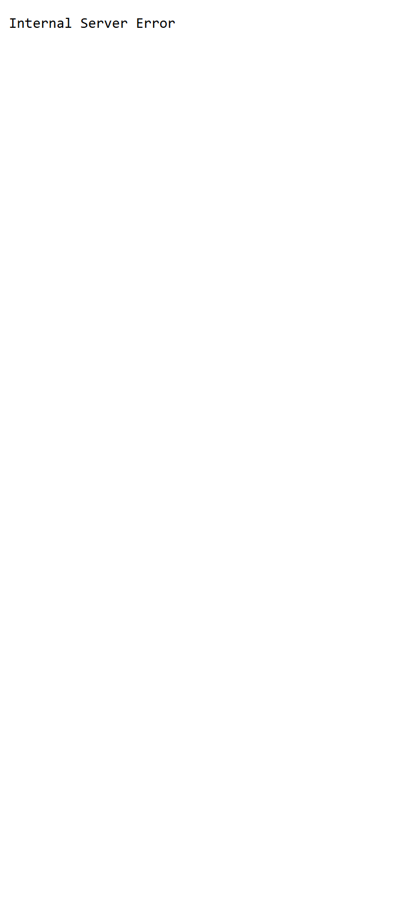 |  |

Páginas completas: `ux-audit/before/before-mobile-*-full.png`. Escritorio: `ux-audit/before/before-desktop-*.png`.

---

## Qué cambia (después)

### Cada problema y su solución

| # | Problema | Qué se ha hecho |
|---|---|---|
| 1 | No hay una acción principal en la home | La home responde a tres preguntas en este orden: **cuánto falta** (cuenta atrás grande: "63 days until you land in Madrid"), **qué hago ahora** (una sola tarjeta "Your next step" con el título del trámite, su primera frase, por qué ahora —plazo y qué desbloquea, sacado del JSON— y un único botón) y **cómo voy** ("3 of 11 steps done · 5 open · 3 locked"). Debajo, "After that" con los 3 siguientes pasos y el motivo de cada bloqueo. La tarjeta de embarque sale de la home y se corrige "Erasmus" por el motivo real. Hay estados para "nada que empezar ahora" (dice qué está esperando) y "todo hecho". |
| 2 | Capas flotantes que tapan contenido | Barra de navegación plana, pegada abajo y con borde fino, en lugar de la píldora flotante con sombra. En móvil, el botón flotante de voz en reposo desaparece: la voz se lanza desde el micrófono de "Ask" o desde More → "Talk by voice", y la llamada activa sigue viéndose. En escritorio no cambia. |
| 3 | Iconos sin texto y asistente escondido | Todas las pestañas llevan etiqueta: **Today · Checklist · Ask · Chats · More**. "Ask" (el asistente) va en el centro y destacado, así que está a un toque desde cualquier pantalla. "More" abre una hoja con la guía de ciudad, documentos, plazos, voz, vuelta a casa, perfil, planes y oficina. La barra lateral de escritorio tiene la misma estructura. |
| 4 | Bloqueos escritos a mano y jerga | Cada fila bloqueada dice en texto normal "🔒 First: **Student visa**". La cabecera es "Your checklist · 3 of 11 done · 5 you can do now · 3 locked", con una leyenda de los 4 estados y de la línea discontinua ("Needs this first"). La letra manuscrita se queda solo en "start here". Cada fila tiene una etiqueta para lector de pantalla ("Step 8: Foreigner identity card. Locked, first finish Student visa. Deadline: …"). Los arcos y la regla de días (la seña de identidad de Chart) siguen ahí. |
| 5 | Acción bajo el pliegue y en pestañas | Sin pestañas. Orden: estado y fuente → bloqueo (si lo hay, con enlace al paso que falta) → descripción → **What to do** (pasos numerados) → **What you need** (documentos con casillas que se guardan en el monedero) → necesita / desbloquea → ayuda. La barra de acción ("Mark as done", "I've started") queda fija encima de la navegación. Al marcar como hecho sale una confirmación con animación: "Done. Now open: …" o "Student visa still needs 3 more steps", y el botón "Next" lleva al siguiente paso. |
| 6 | Selector "Chart / Minimal" a la vista | Se quita de onboarding, checklist y trámite. Queda en Perfil → Preferences → "Checklist style" y sigue funcionando `?design=chart|minimal` para las demos. |
| 7 | Onboarding largo | Bienvenida con un titular, una frase y un botón ("Start · Takes under a minute"). Las personas demo quedan plegadas en "Explore with a demo student". Hay **4 preguntas, una por pantalla y con avance automático**: pasaporte (9 opciones con los principales países de origen), ciudad (Madrid; Barcelona aparece como "coming soon" porque no hay contenido verificado; las demás ciudades del piloto van plegadas), motivo ("Studies: degree, master or exchange") y fecha de llegada (sin valor por defecto). Son **6 interacciones** de principio a fin, medidas con el script de flujo. Ya no se piden nombre, universidad ni duración, porque no cambian el checklist. |
| 8 | Tres tipografías y mayúsculas mono | Una sola familia, Archivo, como pide `DESIGN.md`: los tokens `--font-serif` y `--font-mono` apuntan ahora a Archivo, y se quitan Instrument Serif e IBM Plex Mono (dos descargas de fuentes menos). `eyebrow` y `chip` pasan a minúsculas y tamaño legible (12-12.5 px semibold), lo que arregla de una vez todas las pantallas que los usan. |
| 9 | Accesibilidad, RTL y textos largos | Los objetivos táctiles miden 44 px o más en todo el flujo principal (barra 56 px, acciones 48-56 px). Hay enlace "Skip to content". El onboarding mueve el foco a cada pregunta. Hay anuncios `aria-live` al marcar pasos y en las respuestas del asistente. La hoja More es un `dialog` modal con `inert` cuando está cerrada. Se respeta `prefers-reduced-motion`. Se usan propiedades lógicas (`ps`, `start`, `ms-auto`, `text-start`), las flechas se invierten en RTL (`.flip-rtl`) y la regla y los arcos del checklist se reflejan en RTL. Los títulos usan `overflow-wrap:anywhere` y `hyphens`, y las etiquetas de la barra se parten en 2 líneas en vez de solaparse. |
| 10 | Asistente sobrecargado | Titular corto, una frase de confianza y 4 sugerencias en lista. Se elimina la de "Community", que no se puede responder con contenido verificado. Si falla la red sale un aviso con "Try again". El campo de texto es de 16 px (iOS no hace zoom) y los botones de 44 px. La respuesta sigue mostrando fuente y fecha. |

Otros cambios: la carga muestra un esqueleto en vez de "Loading…". Los anclajes `/tasks#return` ya llevan a "When you go back". El Perfil ya no dice "Erasmus" y aguanta perfiles sin nombre.

### Capturas: después

Móvil, primera pantalla:

| Onboarding | Pregunta 1 | Home | Checklist | Trámite (TIE, bloqueado) | Trámite (en curso) | Asistente |
|---|---|---|---|---|---|---|
| 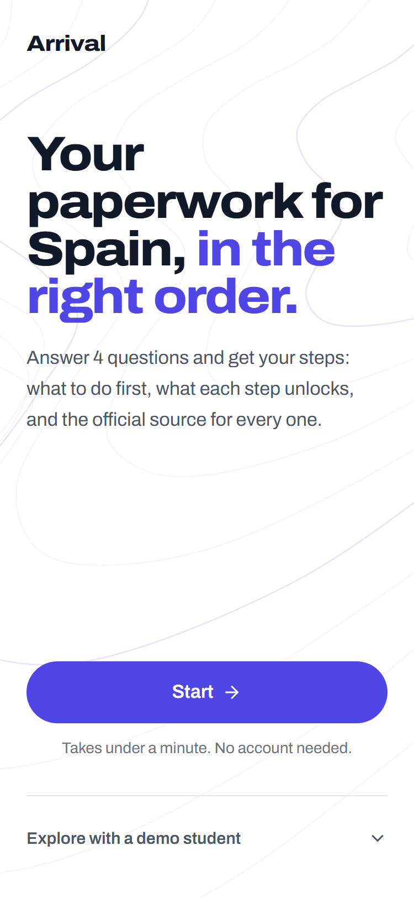 | 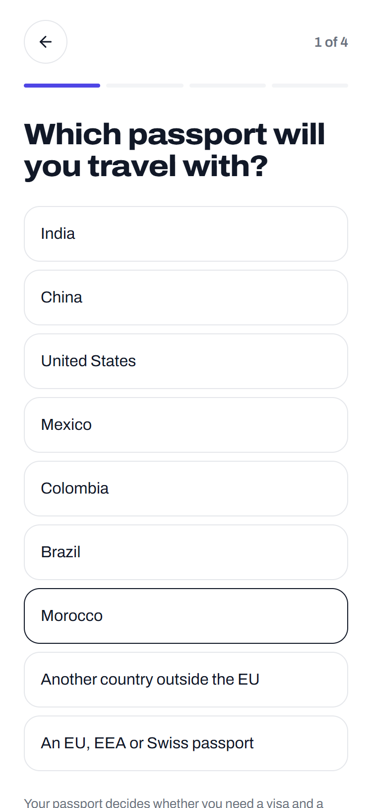 | 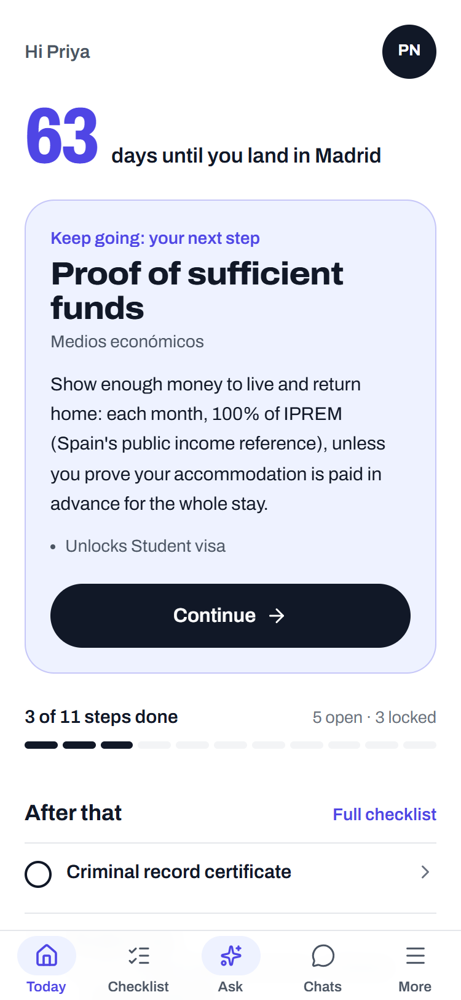 | 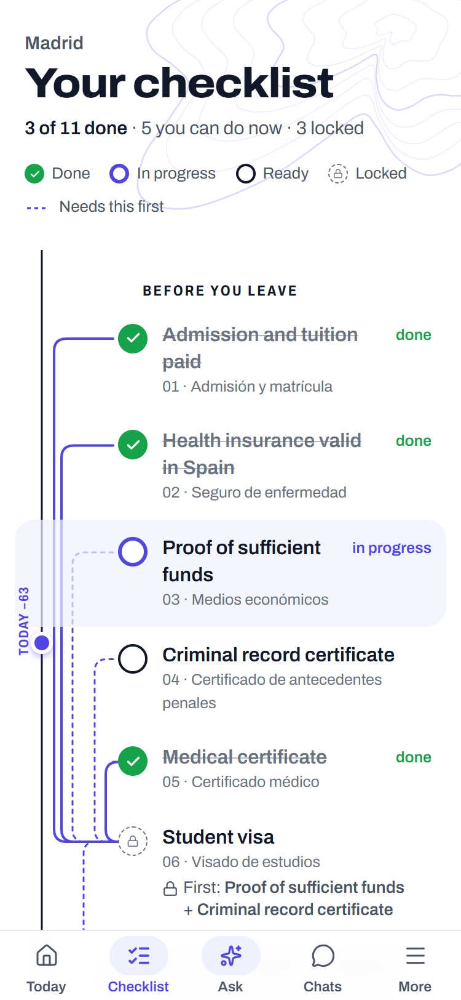 | 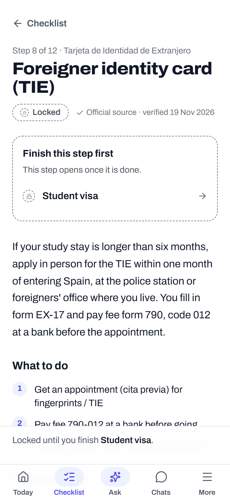 | 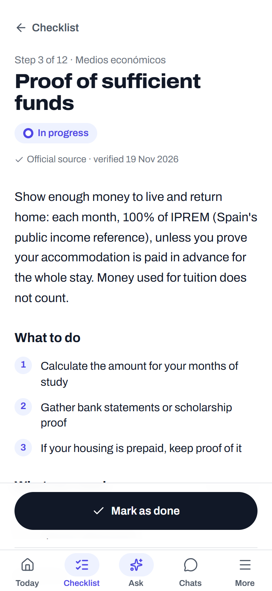 | 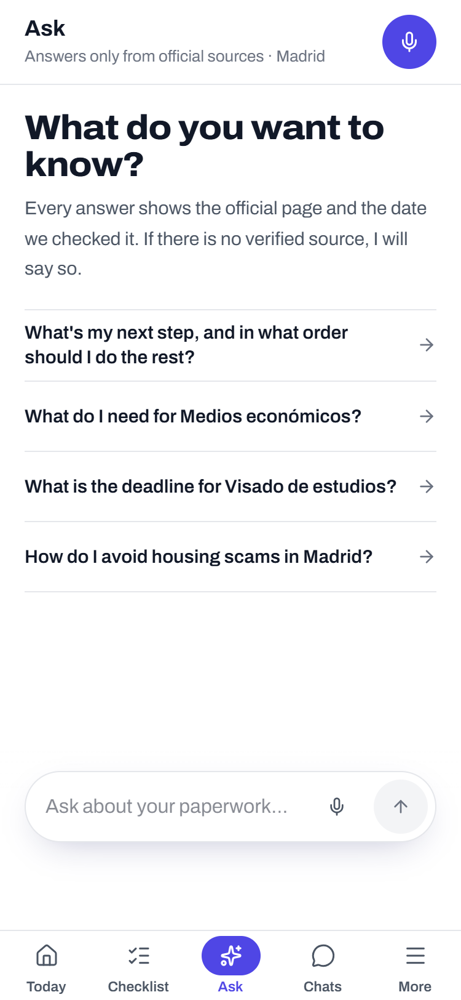 |

Flujo real (script `flow.js`): home de un estudiante nuevo → trámite marcado como hecho → respuesta del asistente con fuente.

| Home nueva | Paso hecho | Asistente |
|---|---|---|
| 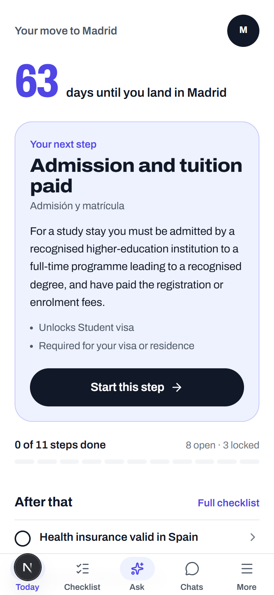 | 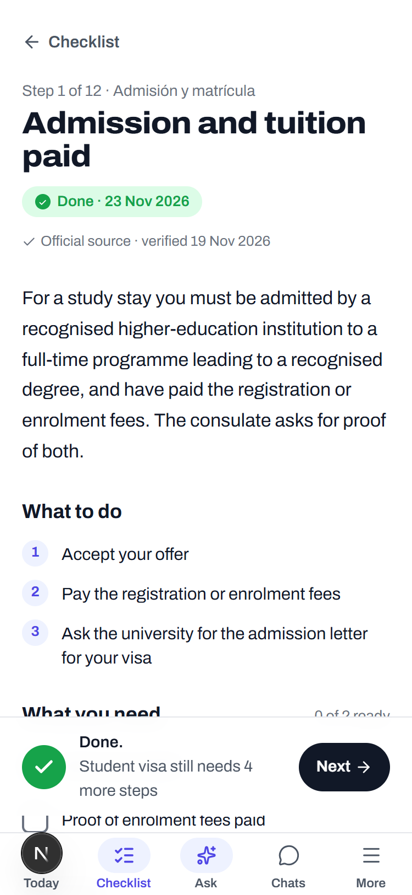 | 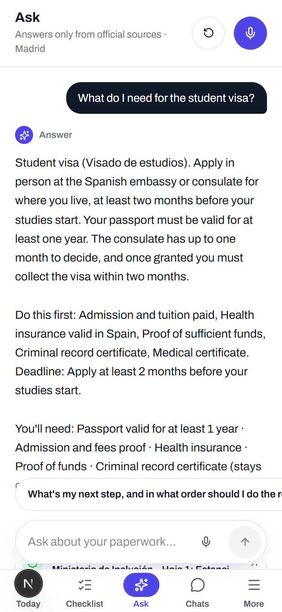 |

Robustez:

| RTL: home | RTL: checklist | RTL: trámite | Texto largo (simulación de alemán) |
|---|---|---|---|
| 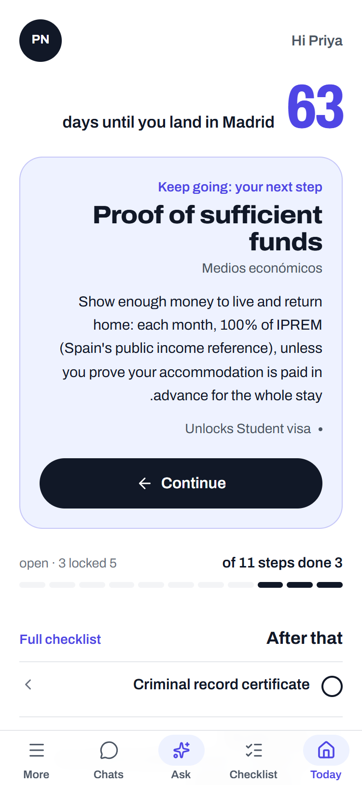 | 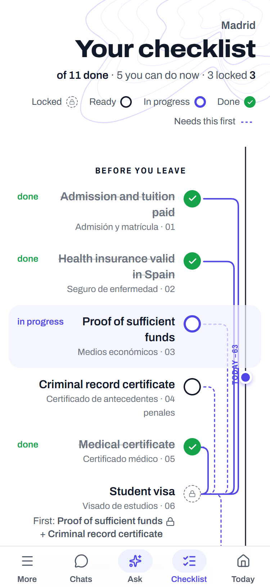 | 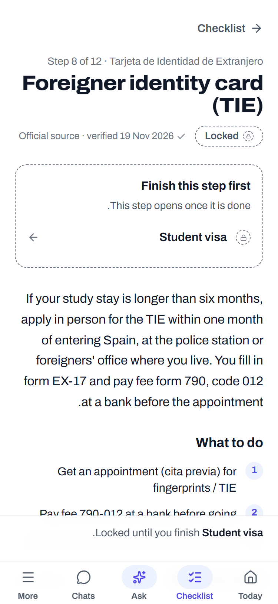 | 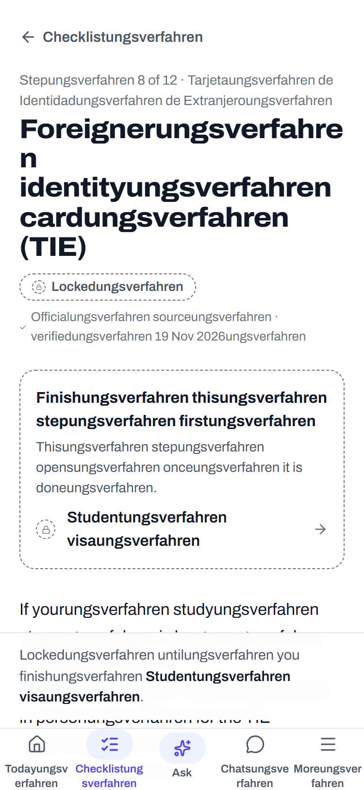 |

Escritorio: `ux-audit/after/after-desktop-*.png`. Páginas completas en móvil: `ux-audit/after/after-mobile-*-full.png`.

### Verificación

- `npm run typecheck` pasa.
- Flujo automatizado en 375 × 812 (`docs/ux-audit/scripts/flow.js`): onboarding (6 interacciones) → home (muestra "Admission and tuition paid" como siguiente paso) → trámite → "Mark as done" (anuncia el cambio y la home pasa a "Health insurance valid in Spain") → pestaña Ask → respuesta en modo offline con la fuente oficial. No hay errores de JavaScript. Hay un único 404 de un recurso estático que ya existía antes.
- Las capturas se regeneran con `node docs/ux-audit/scripts/shoot.js <carpeta> <prefijo> <url>` (necesita `playwright-core` y Chromium de Playwright).

### Lo que queda (siguientes pasos)

1. **i18n (CTO).** Los textos de la interfaz están en inglés dentro de los componentes. Están pensados para extraerlos tal cual a claves. RTL está preparado, pero `dir` lo tiene que poner la capa de i18n en `<html>`.
2. **Barcelona.** Sale como "coming soon". Hace falta `content/barcelona.json` con fuentes verificadas antes de activarla.
3. **Chats, ciudad, documentos y plazos.** Heredan la tipografía y las etiquetas nuevas, pero no se han rediseñado a fondo.
4. **Duración de la estancia.** Ya no se pregunta en el onboarding. Si el contenido empieza a filtrar por duración (por ejemplo, la TIE solo para estancias de más de 6 meses), habrá que añadirla como quinta pregunta opcional.
5. **Botón de voz en escritorio.** Puede tapar contenido en la esquina inferior derecha del detalle del trámite. Lo lleva la sesión de demo (`VoiceAgentMount`).
6. **Pruebas con usuarios.** Falta medir los "5 segundos" con 5 estudiantes reales (prueba de primer clic sobre la home).
